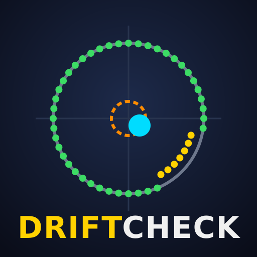
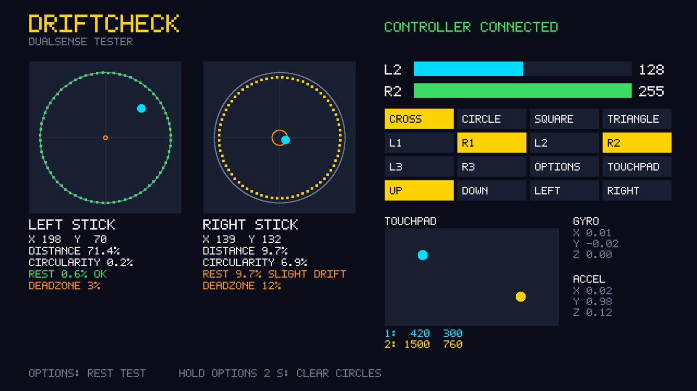

<p align="center">
  
</p>

<h3 align="center">A controller tester for jailbroken PS5s: find stick drift without leaving the console.</h3>

---

DriftCheck is a native PS5 homebrew app that shows everything your DualSense reports and
measures how healthy its analog sticks are. Run the rest test, let go of the sticks for three
seconds, and it tells you whether they drift and which deadzone would hide it.

<p align="center">
  
</p>

<sub>The screenshot is the app's own drawing code rendered on a PC with a scripted controller
(`tools/preview.sh`): the right stick rests off-centre and falls short of the edge.</sub>

## What it shows

- **Both analog sticks**, live, with their raw values and distance from the centre.
- **Circularity**: rotate a stick all the way round and the app traces how far it reaches in
  each of 72 directions, green on the circle and yellow off it, and reports the average error.
- **Rest test**: press and release **Options**, then let go of both sticks for 3 seconds. Each
  stick gets a verdict (OK, slight drift, drift, or "touched, redo") and a suggested deadzone,
  drawn as an orange ring.
- **L2 and R2** as analog values from 0 to 255.
- **Every button an app can read**: Cross, Circle, Square, Triangle, L1, R1, L2, R2, L3, R3,
  Options, the touchpad click and the D-pad.
- **The touchpad**, with up to two fingers and their coordinates.
- **The motion sensors**: accelerometer and gyroscope. DriftCheck tells them apart by which one
  reads gravity.

Hold **Options** for 2 seconds to clear the circularity traces.

### Reading the results

A healthy stick rests within a few percent of the centre. DriftCheck calls **5 %** and above
slight drift and **10 %** and above drift. These thresholds are a starting point, not a
measured standard; the number itself is what to compare between controllers or before and after
a repair. The suggested deadzone is the resting distance rounded up plus two points. Set it in
the games that let you.

### Limits

- **Create and the PS button** never reach an app, so they can't be tested.
- **One controller**: the one of the user who started the app.
- **No battery level** yet.

## Install

You need a jailbroken PS5 running an ELF loader on port 9021 (such as
[elfldr](https://github.com/ps5-payload-dev/elfldr)),
[kstuff](https://github.com/EchoStretch/kstuff-lite) and
[ShadowMountPlus](https://github.com/drakmor/ShadowMountPlus).

**With the installer (recommended).** Send `DriftCheck.elf` from the
[releases](../../releases) to the loader:

```bash
nc -q0 <ps5-ip> 9021 < DriftCheck.elf
```

It writes the app to `/data/homebrew/PPSA98766/` and confirms with a notification;
ShadowMountPlus adds the icon to the home screen within a few seconds. Send a newer
`DriftCheck.elf` the same way to update.

**By FTP.** Extract `PPSA98766.zip` and upload the `PPSA98766` folder to `/data/homebrew/`. The
console only starts an app whose files are all 0777 and shows **CE-107750-0** otherwise. Some
FTP servers store uploads with another mode (zftpd writes 0666); if yours does, run
`python3 chmod-no-ps5.py <ps5-ip> [port]` afterwards.

A diagnostic log is written to `/data/driftcheck/driftcheck.log`.

## Build

On Linux or WSL with Clang (18 or newer), lld, Ninja, Make and Python 3:

```bash
make                            # dist/PPSA98766/ and dist/PPSA98766.zip
bash tools/build-installer.sh   # dist/DriftCheck.elf
make test                       # host unit and integration tests
bash tools/preview.sh           # build/preview.png, the screen with a fake controller
```

The first `make` fetches the pinned public PS5 payload SDK and zlib into `.deps/`. Pushing a tag
equal to `contentVersion` in `sce_sys/param.json` (for example `01.000.000`) makes the GitHub
workflow build, attest and publish `DriftCheck.elf`, `PPSA98766.zip` and `SHA256SUMS`.

The stick math (`src/stick_analysis.*`) has no platform calls and is covered by the unit tests.
The controller layout (`src/pad.cpp`) follows the PS5 SDL port's `PS5_PadData`, checked
against the boilerplate's hardware-tested sample size and field offsets.

## Credits

- Built on [ps5-native-app-boilerplate](https://github.com/blackbearreloaded/ps5-native-app-boilerplate)
  by BlackBearReloaded: the build, FSELF signing, clean-room runtime and renderer. Its tooling,
  documentation and examples are kept under `tools/`, `tooling/`, `docs/` and `examples/`;
  DriftCheck adds the installer, the preview and its own sources next to them.
- [ps5-payload-dev](https://github.com/ps5-payload-dev): the payload SDK, and the controller
  structures of its SDL port.

## License

GPL-3.0-or-later, like the boilerplate it is built on. See [LICENSE](LICENSE).
DualSense and PlayStation are trademarks of Sony Interactive Entertainment; DriftCheck is an
unofficial project, not affiliated with or endorsed by Sony.
